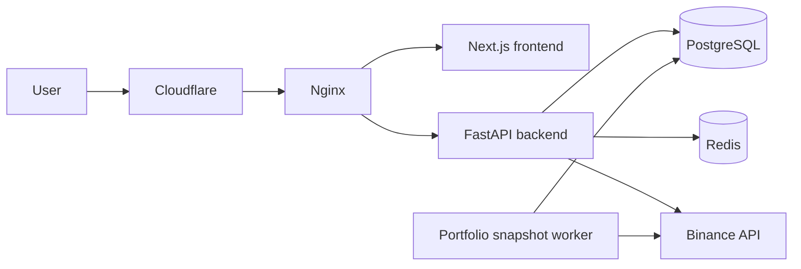

<div align="center">

# LUKI

### A web service for tracking and understanding a crypto portfolio.

LUKI brings a Binance portfolio, its history, and the most important numbers
into one simple dashboard. I built the project from the first product idea to a
working full-stack service with its own backend, frontend, background workers,
database, and deployment infrastructure.

[](https://www.python.org/)
[](https://fastapi.tiangolo.com/)
[](https://nextjs.org/)
[](https://www.postgresql.org/)
[](https://redis.io/)
[](https://www.docker.com/)
[](https://github.com/features/actions)
[](https://www.cloudflare.com/)
[](https://www.binance.com/)

</div>

---

## Why I built it

I wanted to make a product where a user does not have to jump between an
exchange, spreadsheets, and separate dashboards just to understand what is
happening with their portfolio.

LUKI started as a simple portfolio dashboard, but later grew into a complete
service. It can securely connect to Binance, collect account data, save daily
snapshots, and show how the value of a portfolio changes over time. The goal is
to keep everything clear without overwhelming the user with exchange data.

## What it can do

| Feature | What it does |
|---|---|
| Google sign-in | Lets users create an account and sign in through Google OAuth. |
| Binance connection | Connects an exchange account through API credentials encrypted before storage. |
| Portfolio dashboard | Shows the current portfolio value, balances, allocation, and daily changes. |
| Portfolio history | Saves daily snapshots and displays performance for different time periods. |
| Asset overview | Keeps balances and allocation for supported assets in one place. |
| Account management | Lets users review active sessions and disconnect their exchange account. |
| Background updates | Collects portfolio snapshots without requiring the user to keep the page open. |
| CI/CD | Validates the frontend, backend, containers, and infrastructure through separate GitHub Actions workflows. |
| Secure deployment | Runs behind Cloudflare and Nginx with HTTPS, isolated services, automated backups, and versioned releases. |

## How it works



The frontend is responsible for the user experience: authentication, portfolio
charts, exchange connection, profile settings, and account sessions.

The backend keeps the business rules. It validates every request, works with the
database, encrypts exchange credentials, communicates with Binance, and makes
sure one user can never access another user's data.

The portfolio worker runs separately from the web application. It collects a
fresh account snapshot, stores it in PostgreSQL, and makes the history available
to the dashboard. If the process restarts, it can continue without losing the
already collected data or creating duplicate snapshots for the same day.

## Security

Security is a big part of this project because it works with exchange accounts
and financial data.

- Binance credentials are encrypted before they are stored.
- Secrets are never returned by the API or written to application logs.
- Withdrawal access is not required.
- Sessions use secure HTTP-only cookies.
- Every user-owned database query includes an ownership check.
- Financial values use `Decimal` instead of floating-point arithmetic.
- The database keeps an audit trail of important account actions.
- PostgreSQL and Redis are not exposed directly to the internet.

## Architecture

The project is split into three parts:

```text
LUKI
├── frontend       Next.js, React, TypeScript, Tailwind CSS, Recharts
├── backend        FastAPI, SQLAlchemy, Alembic, PostgreSQL, Redis
└── infrastructure Docker Compose, GitHub Actions, Cloudflare, Nginx, backups
```

On the backend I keep a clear dependency direction:

```text
API -> service -> repository -> database
```

API routes handle HTTP and authorization. Services contain business rules.
Repositories are responsible for database queries. Background workers reuse the
same service layer, so portfolio updates follow the same rules as normal API
requests.

## CI/CD and deployment

The project has separate GitHub Actions pipelines for the frontend, backend,
and infrastructure.

- Frontend CI runs linting, TypeScript checks, a production build, and a Docker
  image build.
- Backend CI runs the Python checks, validates the Alembic migration graph, and
  builds the production container.
- Infrastructure CI validates Docker Compose files, Nginx configuration,
  deployment scripts, and checks that secret files are not tracked by Git.

Production deployment is started from a protected GitHub Actions environment
with explicit backend and frontend versions. The workflow connects to the
server through a restricted SSH command that can only start a deployment. The
server then builds or reuses versioned Docker images, applies database
migrations, starts the services, waits for their health checks, and verifies the
public HTTPS page.

If something fails during the release, the deployment script restores the
previous application versions. Deployments are also locked so two releases
cannot change the server at the same time.

Cloudflare manages the public DNS and proxies traffic to Nginx. Nginx routes
frontend requests to Next.js and API requests to FastAPI. Let's Encrypt
certificates are renewed automatically, and the Nginx configuration is
validated before every reload.

## Tech stack

### Frontend

- Next.js 16 and React 19
- TypeScript
- Tailwind CSS
- TanStack Query
- React Hook Form and Zod
- Recharts

### Backend

- Python 3.13
- FastAPI
- Pydantic
- async SQLAlchemy
- Alembic migrations
- PostgreSQL
- Redis
- Binance REST API

### Infrastructure

- Docker and Docker Compose
- GitHub Actions CI/CD
- Cloudflare DNS and proxy
- Nginx
- Let's Encrypt certificates
- Health checks and background workers
- Automated PostgreSQL backups and retention
- Versioned deployments with rollback support

## What I worked on

I built the whole project myself: product logic, database structure, API,
interface, exchange integration, background workers, security rules, and server
infrastructure.

One of the most interesting parts was making portfolio history reliable. The
service has to collect balances regularly, work within Binance API limits, avoid
duplicate daily snapshots, and continue normally after a process restart. I
designed this flow so that PostgreSQL remains the single source of truth and the
dashboard always receives a consistent result.

I also spent a lot of time keeping the interface simple. A user sees the things
that matter — portfolio value, asset allocation, daily changes, and history —
while the more complicated synchronization stays on the server.

## About this repository

This is a public overview of LUKI created for my portfolio. The application
source code and deployment configuration are kept in private repositories.

